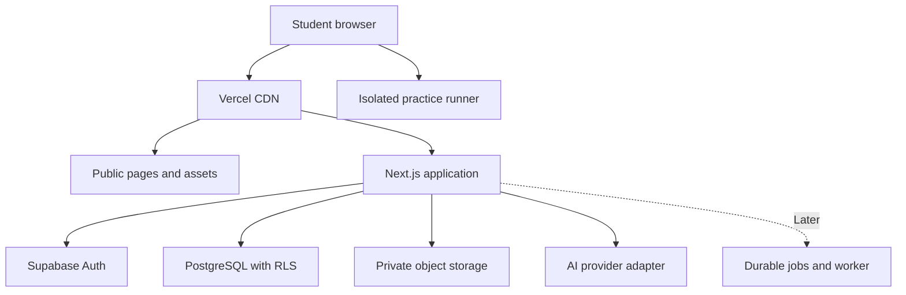
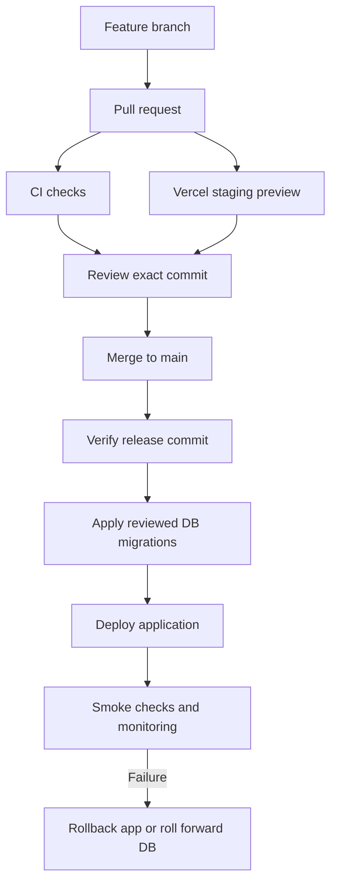

# Nexus Learning — architecture and delivery guide

> Original planning guide from 2026-09-19, preserved for requirements and architecture context. Product, pricing and hosting statements are historical proposals. Use [current progress](PROGRESS.md), [the canonical feature register](features.csv) and [the application README](../README.md) for implementation and setup status.

Planning baseline: 19 September 2026. Owner: Hasan Abbas. Stage: design concepts and proposed backlog. No repository, cloud resources, running application, or deployment has been created by this planning task.

## 1. Recommended starting point

Build one TypeScript Next.js application on Vercel, backed by Supabase PostgreSQL, Auth, and Storage. Keep the code organised into business modules inside one repository. Use GitHub Actions for checks, Vercel for previews, and a controlled production release. Add a live AI provider only after the learning flow works with a clearly labelled mock tutor.

This recommendation changes the earlier MongoDB suggestion because your project now has explicit cost and operational constraints. Enrolments, lesson versions, attempts, reviews, and project submissions have useful relational constraints. Supabase also avoids assembling separate authentication and storage services. MongoDB remains a valid alternative if keeping Mongoose is more important to you; do not operate both databases for the MVP.

Working product scope: English-first programming education for adults/college learners, starting with one reviewed JavaScript course. This is a proposed launch scope, not a restriction on the long-term platform. Global availability, localisation-ready UI, and measurable learning outcomes begin in the foundation. Multiple subjects, institutions, languages, and voice tutoring follow evidence from the pilot.

The three design concepts define the visual direction: public homepage, learner dashboard, and lesson workspace. They are visual references rather than implemented features or proof of usability. Keep approved images in `docs/design/` once their files are available in the repository.

## 2. Free hosting: what is and is not achievable

**A zero-infrastructure-cost personal prototype is feasible within quotas. A commercial Vercel launch is not guaranteed to be free before revenue.** Vercel Hobby is limited to personal, non-commercial use. Its commercial definition includes financial intent and paid work, not just collecting subscription payments. Use local development until the hosting plan fits the actual use. [Vercel Hobby](https://vercel.com/docs/plans/hobby), [commercial-use guidance](https://vercel.com/docs/limits/fair-use-guidelines).

| Stage                                 | Proposed setup                              | Planning cost, USD/month                                           |
| ------------------------------------- | ------------------------------------------- | ------------------------------------------------------------------ |
| Local development                     | Next.js locally, local Supabase, mock tutor | $0 in cloud charges; requires your computer                        |
| Eligible personal/non-commercial demo | Vercel Hobby, Supabase Free, mock tutor     | $0 within quotas                                                   |
| Commercial beta                       | Vercel Pro, Supabase Free while acceptable  | From $20 plus AI, any overages and other services                  |
| More dependable early production      | Vercel Pro, Supabase Pro                    | From $45 plus AI, overages, additional projects and other services |

The listed Vercel Pro starting price is $20/month and Supabase Pro starts at $25/month. These are starting prices, not spending caps. Account configuration, extra seats/projects, taxes, currency conversion, domains, email, and usage can increase the total. [Vercel pricing](https://vercel.com/pricing), [Supabase pricing](https://supabase.com/pricing).

Supabase Free currently lists 500 MB database storage, 1 GB file storage, 5 GB egress plus 5 GB cached egress, 50,000 auth monthly active users, and two active projects. Inactive projects pause after a week. Auth MAU allowance does not mean the database can support that many actively learning users at acceptable latency. [Supabase pricing](https://supabase.com/pricing).

| Database option                   | Why choose it                                                            | Trade-off for Nexus                                                                     |
| --------------------------------- | ------------------------------------------------------------------------ | --------------------------------------------------------------------------------------- |
| Supabase PostgreSQL — recommended | Integrated Auth, Storage and row-level permissions; relational reporting | Free-tier pausing and limits; authorisation policies need careful tests                 |
| MongoDB Atlas Free                | Familiar MERN/Mongoose development; flexible documents                   | Separate auth/storage decisions; 0.5 GB limit and restricted operations/backup features |

Atlas limits: [official free-cluster documentation](https://www.mongodb.com/docs/atlas/reference/free-shared-limitations/). Neon is another PostgreSQL option, but its current pricing page could not be verified in this research, so it is not the basis of this recommendation.

Free tiers do not reserve production capacity or promise an uninterrupted service. Do not use artificial traffic to evade pausing. Recheck terms and limits immediately before provisioning. If free commercial hosting is an absolute requirement, hosting must be reconsidered separately; this plan respects your preference for Vercel and does not silently switch providers.

## 3. Architecture and responsibilities

Use a modular monolith: one deployment, clear internal boundaries, one transactional database. This keeps the first release understandable and affordable while allowing a module to become a separate service later.

| Layer              | MVP choice                                                     | Responsibility                                                      |
| ------------------ | -------------------------------------------------------------- | ------------------------------------------------------------------- |
| UI                 | Next.js App Router, React, TypeScript                          | Server-rendered pages and small interactive client components       |
| Styling            | Tailwind CSS, accessible primitives, shared design tokens      | Consistent components, keyboard interaction, light/dark themes      |
| Motion             | CSS for simple transitions; one React motion library if needed | Modest transform/opacity animations and reduced-motion alternatives |
| Application server | Next.js Route Handlers and Server Actions in Node runtime      | Validate requests, authorise operations, grade attempts, call AI    |
| Database           | Supabase PostgreSQL                                            | Persistent learning records and transactional changes               |
| Authentication     | Supabase Auth with cookie-aware SSR clients                    | Sign-in, session refresh, sign-out and identity verification        |
| Authorisation      | Server checks plus database RLS                                | Enforce record ownership and staff permissions                      |
| Content            | Reviewed, versioned course material                            | Stable lesson and assessment sources                                |
| Files              | Supabase Storage private buckets                               | Assets, later attachments, controlled downloads                     |
| Tutor              | Provider-independent server adapter                            | Live or mock implementation behind the same interface               |
| Tests              | Unit tests, database policy tests, browser tests               | Verify learning rules, isolation, and critical flows                |

Use the current stable versions compatible with each other when scaffolding and commit the lockfile. Do not freeze framework versions from an old example. [Next.js documentation](https://nextjs.org/docs), [Supabase SSR clients](https://supabase.com/docs/guides/auth/server-side/nextjs).

Do not add a separate Express server, Kubernetes, Kafka, Redis, or microservices merely for future scale. Add a queue/worker when you have durable background work such as document ingestion. Never depend on a process continuing after a serverless request ends.

## 4. Global delivery with one database region

Serve static public pages and assets through the CDN. Run database-heavy server functions in the same region as, or close to, the database. For an India-first pilot, inspect available Mumbai or nearby regional options in both providers before choosing. Avoid locating the database in Asia and all application functions in the US by default. [Supabase regions](https://supabase.com/docs/guides/platform/regions), [Vercel function regions](https://vercel.com/docs/functions/configuring-functions/region).

A CDN makes cached content globally accessible; it does not make database writes local to every student. Start with one primary database, measure latency from target countries, and add read replicas or regional services only when the measurements and budget justify them. Replication and regional failover have additional cost and consistency implications.

Use UTC timestamps in storage and save the learner's IANA timezone separately. Display local dates with locale-aware formatting. Define review due times and streak boundaries using the learner's timezone. Avoid daily jobs as a dependency for showing a review: query `next_review_at` when the learner opens the app. Keep copy in translation dictionaries, use Unicode, and allow layouts to accommodate longer translations and future right-to-left text.

## 5. Module boundaries and repository layout

| Path                         | Purpose                                                 |
| ---------------------------- | ------------------------------------------------------- |
| `src/app/(marketing)/`       | Homepage, course discovery, public information          |
| `src/app/(auth)/`            | Sign-in, callback, recovery                             |
| `src/app/(learner)/`         | Today, courses, lesson workspace, projects, progress    |
| `src/app/api/tutor/route.ts` | Authenticated streamed tutor endpoint                   |
| `src/modules/learning/`      | Enrolment, prerequisites, lessons, next-step rules      |
| `src/modules/assessment/`    | Attempts, scoring, feedback, mastery evidence           |
| `src/modules/review/`        | Review scheduling and due-item selection                |
| `src/modules/tutor/`         | Context selection, provider adapter, quotas, evaluation |
| `src/modules/projects/`      | Milestones, submissions and feedback                    |
| `src/components/ui/`         | Shared accessible components                            |
| `src/lib/supabase/`          | Browser and request-scoped server clients               |
| `supabase/migrations/`       | Ordered SQL schema and policy changes                   |
| `supabase/seed.sql`          | Synthetic development data                              |
| `tests/`                     | Unit, policy and browser tests                          |
| `docs/`                      | Build guide, feature register, decisions and runbooks   |

UI components must not own scoring or payment rules. Keep business logic in testable module functions. Route handlers validate inputs and call those functions. Keep provider-specific AI code inside its adapter. For the MVP use Supabase clients and reviewed SQL/RPC where transactions are necessary; adding an ORM is optional, not a prerequisite. Any later direct SQL connection requires appropriate connection pooling and an explicit authorisation strategy.

## 6. Data model and permissions

| Table/group                             | Main fields and constraints                                                          |
| --------------------------------------- | ------------------------------------------------------------------------------------ |
| `profiles`                              | User ID tied to Auth, display name, timezone, locale; private by default             |
| `courses`, `course_versions`            | Stable course ID, slug, published version, editorial state                           |
| `skills`, `skill_prerequisites`         | Skill IDs and prerequisite edges; validate cycles before publishing                  |
| `lessons`, `lesson_versions`            | Stable lesson ID, immutable published content, objective, course-version reference   |
| `enrolments`                            | Unique user/course pair, current lesson, selected course version                     |
| `exercises`, private answer data        | Versioned prompt, rubric and grading configuration; answer keys not browser-readable |
| `attempts`                              | User, exercise version, answer, hint usage, server-derived outcome and timestamp     |
| `skill_evidence`                        | Links from attempts/projects to a skill and scoring-rule version                     |
| `review_items`                          | User, skill, next-review timestamp and scheduling state                              |
| `projects`, `submissions`               | Milestone/rubric version, owner, revision and feedback                               |
| `notes`                                 | User, lesson version, content and last-update timestamp                              |
| `tutor_threads`, `tutor_messages`       | Owner, lesson context, message role and retention dates                              |
| `ai_usage_events`, `quota_buckets`      | Request ID, reserved budget, actual usage, model and atomic quota state              |
| `content_reports`, `admin_audit_events` | Report lifecycle and staff actions                                                   |

Store rich lesson content in a constrained structured format, with flexible JSON where needed. Keep ownership, relationships, timestamps, and frequently queried fields relational. Store file bytes in object storage and metadata in the database. Add indexes for user/course lookups, user/review-due queries and exercise attempts. Paginate long lists.

Enable RLS on exposed tables. Students can access only their private records. Published content can be public according to your product policy. Staff roles must come from trusted server-managed data, not editable profile metadata. Normal requests use the verified user's identity. A privileged secret/service role bypasses normal protections and belongs only in narrowly scoped server jobs. [Supabase RLS](https://supabase.com/docs/guides/database/postgres/row-level-security).

The server must derive user IDs, grading results and protected timestamps. Reject a forged user ID or score supplied by the browser. Make attempt submission idempotent so retries cannot double-count progress. Use database transactions/RPC for multi-record updates. Explicitly control function permissions and search paths if using privileged database functions.

## 7. Learning and AI request flows

**Practice flow:** verify session; load the published exercise version; validate the submitted answer; grade on the server; save the attempt and evidence transactionally; update next steps; return specific feedback. Completion and mastery are different fields. Browser-run tests are formative feedback, not trusted certification evidence.

**Tutor flow:** authenticate; validate size and lesson access; atomically reserve a per-user and global usage allowance; select relevant reviewed lesson content; construct a prompt containing only necessary context; call the configured model with timeout/output limits; stream the response; record actual usage and reconcile the reservation. Use an idempotency key and test simultaneous requests. If usage is uncertain after a timeout, retain a conservative reservation until reconciliation.

Start with direct retrieval of the current lesson and its prerequisites. Add embeddings/vector search only when the corpus becomes large enough to need semantic retrieval. Enforce access checks before retrieving private content and return traceable lesson references. Treat uploaded documents as untrusted content; do not let them override system rules, fetch arbitrary URLs, or trigger privileged actions.

The tutor should offer hints, explanations, examples and follow-up questions. A student should always be able to continue reviewed lessons if the AI provider is unavailable. Mark mock responses clearly. Use an evaluation set covering correct guidance, ambiguity, wrong student reasoning, prompt injection, missing context, language clarity, and refusal to invent sources. Keep prompt/model version metadata so a change can be compared and reversed.

Live AI is not assumed free. A consumer chat subscription does not establish API credits for your application. Configure a provider account separately, keep keys server-side, and use a model-neutral interface. Set an application-side budget cutoff; provider alerts alone should not be treated as a guaranteed hard stop.

For planning, monthly token cost can be estimated as:

`active learners × sessions per learner × turns per session × ((average input tokens × input price per million + average output tokens × output price per million) / 1,000,000)`

Illustration only: 100 learners × 12 sessions × 6 turns, averaging 1,500 input and 350 output tokens, produces 10.8 million input tokens and 2.52 million output tokens. Multiply by your chosen model's verified rates. This excludes embeddings, retries, voice, tools, hosting and storage. Context growth matters; avoid resending unlimited histories. No specific model price is assumed here.

## 8. Student code execution

Never run arbitrary student code with `eval`, `child_process`, or a normal Node sandbox inside the application server. Do not put secrets in a browser execution environment. A same-origin Web Worker alone is not a security boundary for untrusted code.

For simple JavaScript practice, either use constrained non-executable exercises in the initial beta or build a separately reviewed browser runner on an isolated origin with a strict sandbox/CSP. Block network access, restrict messages to a validated protocol, cap output, and terminate execution at a short timeout. Test infinite loops and attempts to access parent storage/network. Cross-origin isolation and browser compatibility need explicit verification.

For authoritative grading or languages requiring a backend, use an isolated execution service with resource and network controls. Budget this separately. The learning API stores results only from a trusted verifier; client-supplied test passes never grant certification or privileged progress.

## 9. UI quality and animation specification

Use the approved midnight navy, violet and cyan direction. Extract shared colour, spacing, border, typography and elevation tokens before implementing screens. Build the components first, then compose pages. Design loading, empty, error, saved, denied and offline states alongside successful screens.

| Interaction            | Initial motion target                                     |
| ---------------------- | --------------------------------------------------------- |
| Button press/hover     | 120–180 ms feedback                                       |
| Tab selection          | 180–220 ms indicator transition                           |
| Drawer or tutor panel  | 200–300 ms transition                                     |
| Card hover             | 2–4 px lift on fine pointers                              |
| Hero decoration        | Slow movement that pauses off-screen                      |
| Reduced-motion setting | Static decorative graphics, minimal essential transitions |

Use transform/opacity animation where possible. Keep scrolling and reading stable. Never animate lesson text continuously. Lazy-load the code editor and 3D assets. Prefer a lightweight static hero on lower-powered devices. Preserve the same information when animation is disabled.

Acceptance targets: keyboard access, visible focus, labelled inputs, adequate contrast, no clipping at 320 px, mobile tutor as a dedicated screen/tab, and no essential hover-only actions. Test at representative mobile, tablet and desktop widths. Use [WCAG 2.2 guidance](https://www.w3.org/WAI/WCAG22/quickref/).

Performance goals for real-user measurement: p75 LCP no more than 2.5 seconds, INP no more than 200 ms, and CLS no more than 0.1. These are release targets, not measured results for the concepts. Evaluate the actual device/network mix and report lab and field measurements separately. [Core Web Vitals](https://web.dev/articles/vitals).

## 10. Development, staging and production

| Environment          | Database/data                                   | Credentials and behaviour                                   |
| -------------------- | ----------------------------------------------- | ----------------------------------------------------------- |
| Local                | Local Supabase with synthetic fixtures          | Local keys, mock AI by default                              |
| Pull-request preview | Dedicated staging project or mock-only fixtures | Staging credentials, no production data, restricted live AI |
| Production           | Separate production project                     | Production-only secrets, live quotas, backups               |

Two hosted free Supabase projects can cover staging and production within the current allowance if the account has capacity. They are not automatic per-PR database branches. Shared staging requires coordination: do not let every preview migrate its schema. Apply reviewed backward-compatible migrations through a single staging process. For incompatible experiments use local databases or separately budgeted disposable branches.

Use the cookie-based Supabase SSR integration and verify identity on server requests. Configure OAuth callback URLs separately for local/staging/production. Avoid overly broad production redirect allowlists. Public content can be cached; learner-specific responses and auth cookies must not be shared through CDN caching. [Supabase SSR](https://supabase.com/docs/guides/auth/server-side/nextjs).

Required configuration includes a public Supabase URL and publishable key, plus server-only secrets for AI and privileged operations if those operations exist. Public keys are not a replacement for RLS. Never prefix server secrets with `NEXT_PUBLIC_`, commit `.env.local`, or include private records in logs. Use a placeholder-only `.env.example`.

Email authentication needs a production email decision. Supabase's default email service is intended for testing and has recipient/rate restrictions. Configure a suitable custom SMTP service before relying on public email sign-up or recovery. OAuth may simplify the initial sign-in flow, but does not solve every account-recovery or notification requirement. [Supabase SMTP](https://supabase.com/docs/guides/auth/auth-smtp).

## 11. CI/CD: yes, from the first working slice

CI means automatically checking a code change. CD means delivering a tested version to an environment. Start small and keep release order explicit.

On pull requests run dependency installation from the lockfile, formatting checks, lint, TypeScript checks, unit tests and a production build. Add a database job that creates a clean local database, applies every migration and seed, tests permissions for anonymous/user A/user B/staff, and verifies generated types. Add browser tests for sign-in, enrolment, one exercise, progress persistence and session expiry. Mock external AI in normal CI.

Use GitHub Actions with read-only default token permissions, timeouts, cancellation of superseded PR runs, short artifact retention and minimal secrets. Do not run untrusted pull-request code with production credentials. Do not use `pull_request_target` to execute a contributor's code. Pin third-party actions to reviewed commit SHAs before production. [GitHub Actions billing](https://docs.github.com/en/billing/concepts/product-billing/github-actions).

Vercel can create Git-linked preview deployments. A green preview alone is not the CI gate, and automatic deployment can race an independent GitHub Actions job. **Disable automatic production promotion for the chosen controlled-release setup.** Keep previews automatic, then release an explicitly selected passing main-branch commit through one documented manual/CI procedure. Test the actual Vercel project configuration. [Vercel Git integration](https://vercel.com/docs/git/vercel-for-github).

For the first releases, a manual operator follows the runbook: confirm the exact SHA passed CI, inspect migration effects, verify recovery, apply additive migrations, deploy that SHA with production variables, and run smoke checks. Later automate that same order in one release workflow with a concurrency lock. Database migration must not run in `next build` or every preview build.

Where your GitHub plan supports it, require status checks and reviews on protected branches and use protected production environments. Availability differs between public and private repositories and account plans. If private-repository gates require payment, use a documented manual release initially and be explicit that it lacks enforced protection. CI runtime/artifact quotas still need monitoring. [GitHub branch protection](https://docs.github.com/en/repositories/configuring-branches-and-merges-in-your-repository/managing-protected-branches/about-protected-branches).

The kit includes a `ci.yml.template` for basic checks. It is intentionally not an active workflow. It requires a scaffolded application, the named package scripts, a lockfile, and local/mock test configuration. Database and browser jobs must be added before the beta release. It has not been executed against an application because no application exists yet. Review the official [checkout action](https://github.com/actions/checkout) and [Node setup action](https://github.com/actions/setup-node) before selecting immutable action versions.

## 12. Migrations, rollback and recovery

Treat SQL migrations as reviewed code. Rebuild a clean local database from them in CI. Generate TypeScript database types after schema changes and detect drift. Keep hosted dashboard edits out of the normal schema workflow. [Supabase environment management](https://supabase.com/docs/guides/deployment/managing-environments).

Use expand-and-contract changes: add a nullable field/table, deploy code that tolerates old and new data, backfill safely, switch reads/writes, and remove obsolete fields in a later release. This preserves application rollback. A Vercel rollback does not undo database changes. Destructive down migrations are not the default recovery method.

For a small pilot, proposed objectives are an RPO of 24 hours and RTO of 4 hours; these are unproven targets, not service promises. Keep encrypted backups outside the live database and rehearse restoration into a separate environment. Choose paid recovery features when student progress becomes important enough that these targets are insufficient. Free plans should not be treated as providing a complete production backup service. [Supabase backups](https://supabase.com/docs/guides/platform/backups).

Back up database records and file bytes separately. A database backup does not restore the actual objects stored through Supabase Storage. Include identity/auth records and necessary configuration in the documented recovery procedure, while keeping secret values in a secure recovery channel. Never commit production exports to Git. Test that restored users, progress and files still work together.

## 13. Operational quality and student trust

Collect request IDs, route latency, error rate, DB performance, AI token usage and budget reservations. Redact emails, tokens and student chat content from ordinary logs. Start with platform logs and a small error-monitoring setup; add more tooling only when it resolves an operational gap.

Track learning outcomes: diagnostic-to-follow-up improvement using comparable tasks; success on unseen problems without hints; retained understanding after a delay; project rubric improvement. Also track lesson abandonment and reported content errors. Time spent and streaks do not establish mastery. Use a clear analytics event schema and avoid sending private code/chat by default.

Provide private-by-default profiles, account data export/deletion, retention controls and a way to report incorrect tutor guidance. Publish truthful privacy and terms pages before a public beta. This planning guide does not establish legal compliance or data-residency guarantees. Before targeting minors or schools, review age-appropriate account, consent, moderation and data-processing requirements for the target jurisdictions with qualified support.

Create a short incident runbook: disable live AI if cost or safety controls fail, keep reviewed lessons available, identify the affected release, restore service, communicate material effects, and record corrective work. Add a status endpoint that exposes no configuration or secrets.

## 14. Build milestones and launch gates

| Milestone         | Deliverable                                                 | Gate to proceed                                                                |
| ----------------- | ----------------------------------------------------------- | ------------------------------------------------------------------------------ |
| M0 Foundation     | Repository, tokens, schema, environment plan, basic CI      | A clean clone can run and check the app using documented setup                 |
| M1 Learning slice | Sign-in, one course, lesson, exercise, saved progress       | Two users cannot access each other's records; refresh retains correct progress |
| M2 Tutor          | Labelled mock, then metered live tutor                      | Evaluation cases and concurrent quota tests pass; non-AI fallback works        |
| M3 Beta           | Projects, review, admin workflow and operational readiness  | Recovery, release, privacy, accessibility and performance checks pass          |
| Later             | More languages, voice, simulations, peers and organisations | Evidence of learning value, sustainable costs and support capacity             |

This is a sequence, not a promised delivery schedule. Start with one end-to-end learning slice before expanding the course catalogue. Review progress weekly, choose a small batch of Ready items, and keep at most one or two development items In progress at a time.

Pilot with roughly 10–20 volunteer learners as a planning target. Observe where they get stuck, compare their independent performance over time, and review per-learner AI cost. Do not call the product globally production-ready until the actual rollout gates have been verified.

## 15. How to use the feature tracker

`Nexus_Learning_Feature_Tracker.xlsx` contains a prioritised proposed backlog. Every feature is initially Planned or Backlog; images and this guide do not count as implemented code. The summary reports completed feature count, not effort-weighted delivery percentage. Owners, deadlines, issue links and evidence are intentionally blank until assigned.

Statuses: Backlog, Planned, Ready, In progress, In review, Blocked, Done, Deferred. Priority P0 means required for the first complete release slice or a launch gate; P1 adds beta value; P2 is later. Effort S/M/L is an initial relative size, not a day estimate.

Add a unique NX ID, phase, priority, acceptance criteria and dependencies for each new feature. Update owner, target date, blocker/next action and issue/PR link as work happens. Mark Done only after acceptance criteria, relevant checks, and a reviewable result are recorded. Dependencies are an explicit list for review, not an automatically scheduled plan.

The worksheet supports rows 14–513 for its initial 500-item reporting range. Insert/extend the Excel table when adding a row; validations are already applied across this range. If you exceed 500 items, extend the summary formulas and validation ranges. Use dates as actual date cells, not text. Filters narrow the view; headline counts intentionally cover the full register.

The kit contains `docs/features.csv` as the initial machine-readable mirror. It does not live-sync with Excel or GitHub. Use Excel while planning; when coding begins, select one canonical register. Recommended: keep the CSV in Git and create issues linked by NX ID. Regenerate spreadsheet snapshots from the CSV, or export reviewed Excel edits back to CSV before Codex work. Do not maintain competing status histories.

## 16. Working with Codex

Unzip the kit into a new local project folder, read its README, and copy `AGENTS.md` and `docs/` into the repository. Merge instructions carefully if a repository already has an AGENTS file. Keep workflow examples in `templates/` until an application exists and the configuration is reviewed.

Give Codex one vertical slice at a time. Reference NX IDs and acceptance criteria. Ask it to inspect the existing repository first, explain any necessary decision, implement the slice, run the relevant checks, and update the canonical register with evidence. A local coding session needs no ChatGPT plugin to edit local files. Use a connected GitHub integration or authenticated Git client for repository operations when needed. Hosting/database account access is required only for provisioning and deployment.

Do not paste secrets into chat. Configure them through local environment files ignored by Git, or the relevant provider's secret settings. No database or deployment account needs to be connected just to use this planning kit.

Suggested first request:

> Read AGENTS.md, docs/BUILD_GUIDE.md, and docs/features.csv. Inspect the repository. Implement NX-001, NX-002, NX-003 and the basic checks portion of NX-036 as one reviewable foundation slice. Use Next.js, TypeScript, the shared design tokens and the supplied homepage concept. Use clearly labelled local fixtures. Keep live AI disabled. Create working scripts and meaningful tests for the implemented behaviour. Update only those feature statuses justified by evidence, and record any partial work. Produce a responsive local preview and a clear list of remaining setup steps. Do not claim that the backend, database, CI or deployment is live unless it has actually been configured and verified.

The next slice should add migrations, auth, RLS, one reviewed course, one protected exercise submission, and saved progress. Only then connect the live tutor.

## 17. Upgrade decisions

Upgrade on actual need rather than a fixed user count. Review capacity when DB/egress usage approaches about 70% of the current allowance, when pauses are unacceptable, when latency rises, or when recovery requirements exceed the available backup approach. The 70% value is an operational planning threshold, not a provider limit.

Improve query indexes and pagination before buying a bigger database. Move large media out of the critical rendering path. Add durable jobs when synchronous work exceeds request limits. Add isolated compute for authoritative code execution. Add regional reads only after cross-region performance is a demonstrated bottleneck. Revisit AI price/quality with a fixed evaluation set before changing models.

Budget and terms should be checked again at launch. This guide intentionally promises no permanent free tier, unlimited scale, or automatic enterprise compliance.
